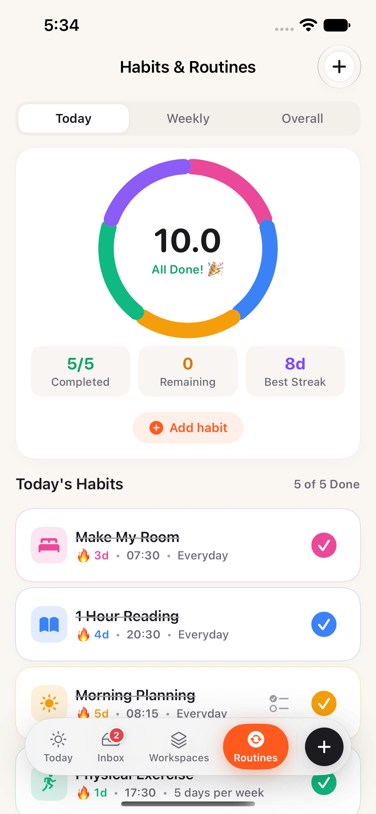
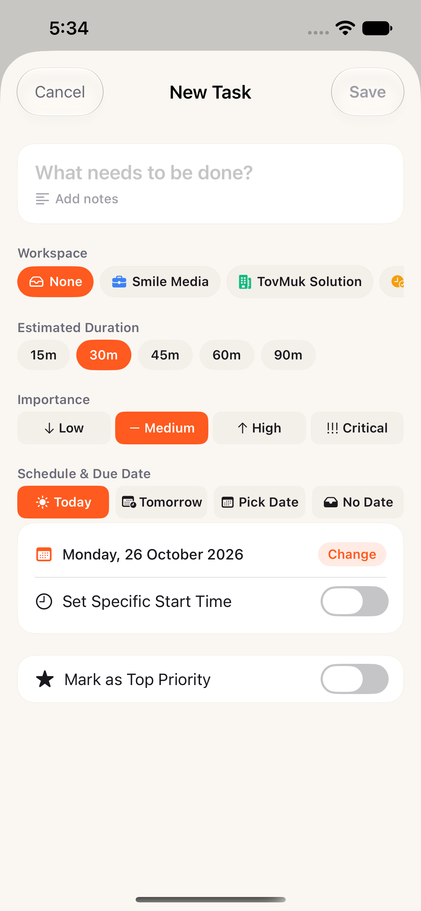
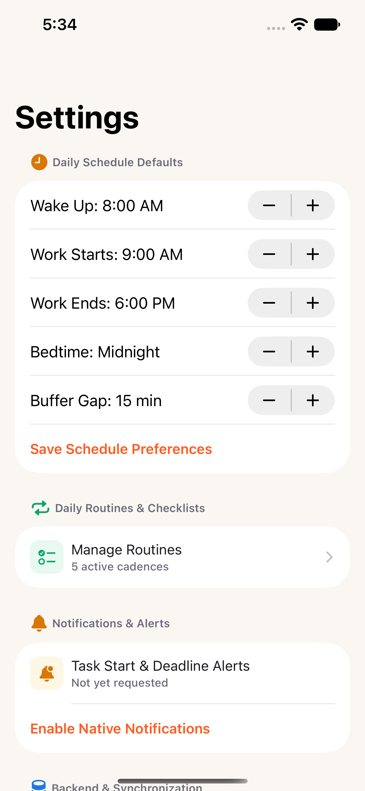

# Daymark — Native iOS Operating System

<p align="center">
  
</p>

<p align="center">
  <strong>A calm, offline-first personal operating system for founders, engineering leads, and multi-venture builders.</strong><br>
  <sub>Developed by <strong>Seng Chhunsour</strong></sub>
</p>

<p align="center">
  <a href="#visual-showcase"></a>
  <a href="#technical-architecture"></a>
  <a href="#technical-architecture"></a>
  <a href="#offline-first-architecture"></a>
  <a href="#test-coverage-31--31-passing"></a>
  
</p>

---

## Overview

Most task managers fail multi-venture operators because they force every responsibility into an overwhelming, flat list. **Daymark** is engineered around three fundamental questions at any hour of the day:

1. **What should I focus on right now?**
2. **What comes next on my timeline?**
3. **What genuinely matters today?**

Inspired by the spatial discipline of **Cultured Code's Things 3** and the operational speed of **Linear**, Daymark combines **deterministic schedule allocation**, **Apple HIG Inset Grouped hierarchies**, and **fluid spring micro-interactions** wrapped in a Warm Sunrise Orange (`#FF5A1F`) design system.

---

## Visual Showcase

### Primary Workflows

| 1. Today View (Light) | 2. Today View (Dark) | 3. Quick Capture Inbox | 4. Workspaces & Ventures |
| :---: | :---: | :---: | :---: |
|  |  |  |  |
| **Real-Time Execution**<br>Breathing focus aura, week calendar scrubber, and chronological timeline. | **OLED Calm Dark Mode**<br>True charcoal and warm sunrise accents designed for low-fatigue night work. | **Frictionless Inbox**<br>Fast title capture, workspace chips, priority flags, and swipe actions. | **Things 3 Inset Grouped**<br>Clean active/completed separation with 16×16 progress pies & instant search. |

### Secondary Surfaces & Modals

| 5. Workspace Detail | 6. Routines & Streaks | 7. Quick Capture Sheet | 8. Daily Schedule Defaults |
| :---: | :---: | :---: | :---: |
|  |  |  |  |
| **Strategic Deliverables**<br>Milestones with clear target outcomes and unified card surfaces. | **Multi-Segment Donut Ring**<br>Daily habits and checklist completion without historical reset. | **Tactile Task Creation**<br>Duration pills (`15m`–`90m`), importance levels, and date selector. | **Boundary Engineering**<br>Fixed work hours, buffers, bedtime, and native alert controls. |

---

## Core Product Principles

### 1. 100% On-Device & Zero Cloud Dependency
Daymark requires **no external database, no mandatory user accounts, and no cloud server**. All tasks, workspaces, routines, milestones, and schedule profiles are persisted atomically as structured JSON documents directly in the iOS sandbox (`Application Support/DaymarkData/`). Your data belongs entirely to your phone.

### 2. Apple HIG Inset Grouped Workspaces
Instead of cluttered, candy-colored dashboard widgets, Workspaces are structured strictly following Apple Human Interface Guidelines:
- **Active Workspaces** live together in a calm, unified Inset Grouped container with indented hairline dividers.
- **Things 3 Progress Pies** (16×16) reflect task completion ratios gracefully without harsh colored horizontal bars.
- **Completed Workspaces** stay organized below in an archive container with soft mint `✓ Done` chips.
- **Instant Search** filters projects instantly as you type.

### 3. Apple-Grade Spring Motion & Micro-Interactions
- **Sliding Capsule Navigation:** Smooth floating dock and segmented pickers built with SwiftUI `@Namespace` and `matchedGeometryEffect`.
- **Celebratory Checkbox Physics:** Completing any task triggers an expanding celebratory ripple ring, a spring bounce (`1.2` → `1.0`), and native `UINotificationFeedbackGenerator().notificationOccurred(.success)` haptic feedback.
- **Breathing Focus Aura:** The active focus card softly pulses with an autoreversing halo when a task is currently executing.
- **Tactile Button Compression:** Primary buttons and FABs utilize custom spring styles (`DaymarkPressableStyle` and `DaymarkBouncyPressableStyle`) with physical resistance.

### 4. Deterministic Capacity-Aware Scheduling
Daymark rejects black-box AI hallucinations. Scheduling is computed deterministically by `SchedulingEngine.swift`:
- Respects hard **Work Hours commitments** (e.g., 9:00 AM – 6:00 PM for Smile Media).
- Automatically protects **15-minute buffer gaps** between focused execution blocks.
- Allocates slots by **Importance Rank** (Critical > High > Medium > Low).
- Any task exceeding daily capacity remains gracefully in the unscheduled tray rather than overflowing your calendar.

---

## Technical Stack & Architecture

```
daymark-ios/
├── Daymark.xcodeproj/             # Native Xcode Project configuration
├── Daymark/
│   ├── App/
│   │   ├── DaymarkApp.swift       # Lifecycle entry point
│   │   └── ContentView.swift      # Floating dock navigation with matchedGeometryEffect
│   ├── Core/
│   │   ├── DesignSystem/
│   │   │   ├── ColorTokens.swift  # Warm Sunrise Orange (#FF5A1F) & Calm Charcoal tokens
│   │   │   ├── TypographyTokens.swift # SF Pro typography system scale
│   │   │   ├── SpacingTokens.swift # 4pt grid system tokens
│   │   │   └── Components/        # DaymarkButton, DaymarkCheckbox, SquircleIcon, Badge
│   │   ├── Models/
│   │   │   ├── DaymarkTask.swift  # Duration, status, importance & priority models
│   │   │   ├── DaymarkProject.swift # Workspaces with hex colors & SF Symbols
│   │   │   ├── DaymarkMilestone.swift # Strategic milestones & target outcomes
│   │   │   ├── DaymarkRoutine.swift # Cadenced habits with date-keyed completion
│   │   │   └── UserScheduleProfile.swift # Wake-up, work hours, buffers, bedtime
│   │   ├── Scheduling/
│   │   │   ├── TimeSlot.swift     # Non-overlapping timeline allocations
│   │   │   ├── SchedulingEngine.swift # Deterministic capacity scheduler
│   │   │   └── MissedTaskDetector.swift # Overdue task detector
│   │   ├── Persistence/
│   │   │   ├── DaymarkRepository.swift # Abstract persistence protocol
│   │   │   ├── LocalDaymarkRepository.swift # Thread-safe actor JSON persistence
│   │   │   ├── SeedData.swift     # Starter workspaces, routines & sample tasks
│   │   │   └── SupabaseConfig.swift # Optional remote sync readiness
│   │   ├── Notifications/
│   │   │   └── DaymarkNotificationManager.swift # Native on-device UNUserNotificationCenter
│   │   └── State/
│   │       └── AppState.swift     # Central @Observable @MainActor coordinator
│   └── Features/
│       ├── Today/                 # Focus Card, Priorities, Timeline, Week Strip
│       ├── Inbox/                 # Rapid capture tray, filter chips, triage editor
│       ├── Projects/              # Inset Grouped Workspaces & Project Detail
│       ├── Routines/              # Habits, Donut Ring Chart & Checklists
│       ├── DailyReview/           # Morning Confirmation & Evening Planning sheets
│       └── Settings/              # Schedule preferences & notification controls
└── DaymarkTests/                  # Comprehensive automated XCTest suite (31 tests)
```

---

## Test Coverage (31 / 31 Passing)

Daymark is backed by a 100% passing automated test suite covering all core business logic, domain invariants, scheduling rules, and persistence:

```bash
# Execute full unit test suite on iOS Simulator
DEVELOPER_DIR=/Applications/Xcode.app/Contents/Developer \
xcodebuild test -project Daymark.xcodeproj -scheme Daymark -destination 'platform=iOS Simulator,name=iPhone 17e'
```

| Test Suite | Tests | Status | Key Invariants Verified |
| :--- | :---: | :---: | :--- |
| **DomainModelTests** | 6 | `PASSED` | Non-empty task titles, positive duration bounds, milestone outcomes, date-keyed routine histories without destructive resets. |
| **SchedulingEngineTests** | 5 | `PASSED` | Critical/High priority first, zero overlapping slots, strict 15-min buffer gaps, work hours boundaries, capacity limits. |
| **MissedTaskDetectorTests** | 4 | `PASSED` | Overdue tasks flagged, completed/future tasks ignored, zero silent auto-rescheduling without user approval. |
| **NotificationManagerTests** | 3 | `PASSED` | Stable notification IDs (`task-start-<UUID>`, `task-deadline-<UUID>`), 60-min advance deadline warnings, priority filters. |
| **RepositoryTests** | 3 | `PASSED` | Automatic first-launch seeding, atomic JSON file persistence across fresh repository instances, full CRUD cycles. |
| **AppStateTests** | 4 | `PASSED` | 5-priority hard cap enforcement, deterministic auto-scheduling, task promotion/demotion, missed task resolution actions. |
| **DesignSystemTests** | 3 | `PASSED` | Dynamic light/dark color token resolution, SF Pro typography scale, systematic spacing and corner radius tokens. |
| **Total** | **31** | **`100%`** | **0 Failures · 0 Regressions · Execution Time: ~0.35s** |

---

## Build & Run Instructions

### Prerequisites
- macOS 14.0+ (Sonoma or Sequoia)
- Xcode 16.0+
- iOS 17.0+ Simulator (e.g. `iPhone 17e`, `iPhone 16 Pro`)

### Command-Line Compilation & Launch

```bash
# Set Xcode developer environment
export DEVELOPER_DIR=/Applications/Xcode.app/Contents/Developer

# Build Daymark scheme for Simulator
xcodebuild build -project Daymark.xcodeproj -scheme Daymark -destination 'platform=iOS Simulator,name=iPhone 17e'

# Install and launch on booted iOS Simulator
xcrun simctl install booted /Users/mac/Library/Developer/Xcode/DerivedData/Daymark-foeifkboxsytygaylmabvfbcewak/Build/Products/Debug-iphonesimulator/Daymark.app
xcrun simctl launch booted com.chhunsour.Daymark
```

---

## Author & Developer

**Developed by Seng Chhunsour**
- **GitHub:** [@Chhunsour](https://github.com/Chhunsour)
- **Repository:** [https://github.com/Chhunsour/daymark-ios](https://github.com/Chhunsour/daymark-ios)

---

## License

Personal and proprietary software. Developed by Seng Chhunsour. All rights reserved.
