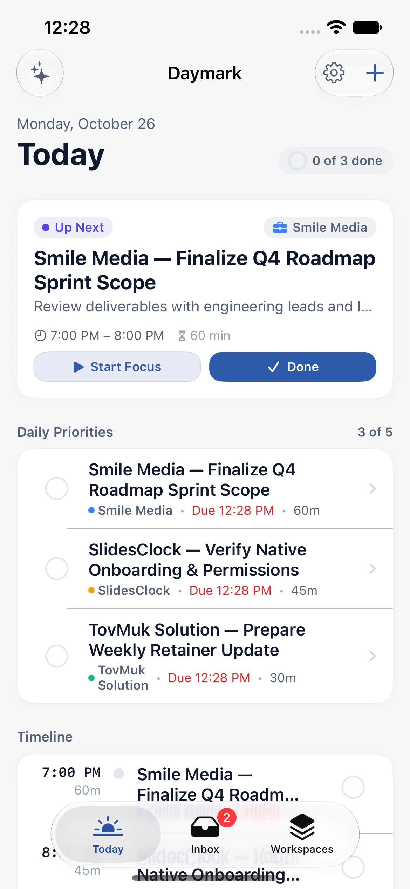
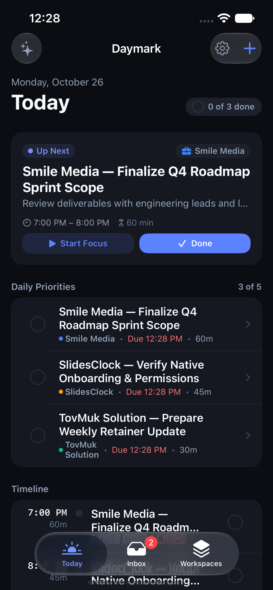
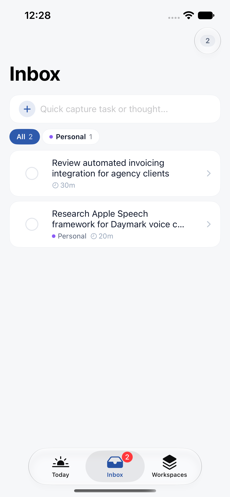
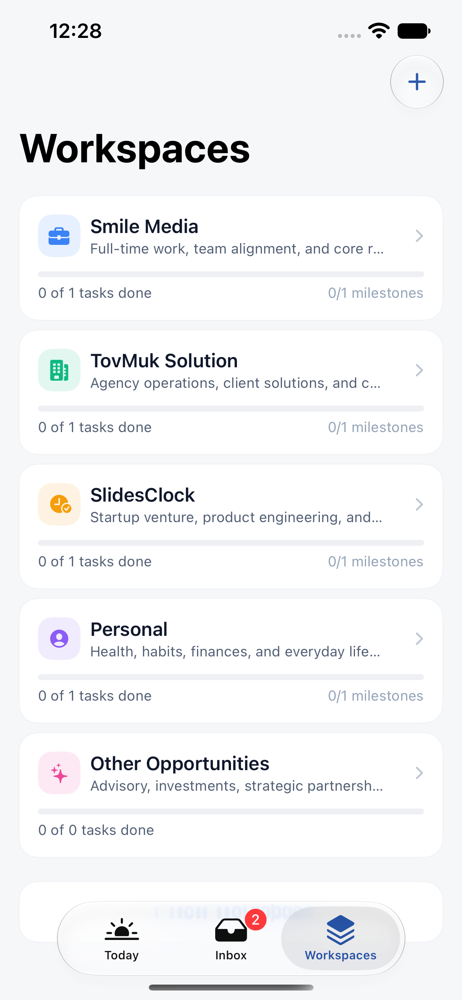
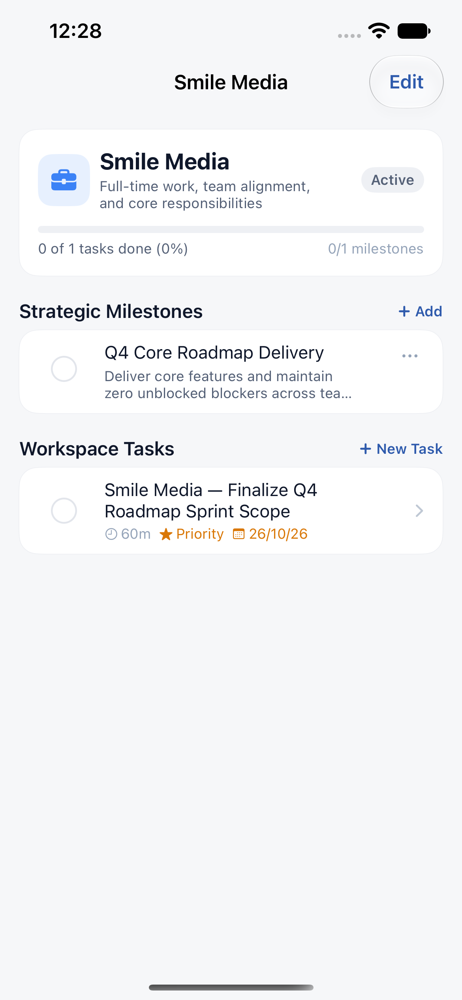
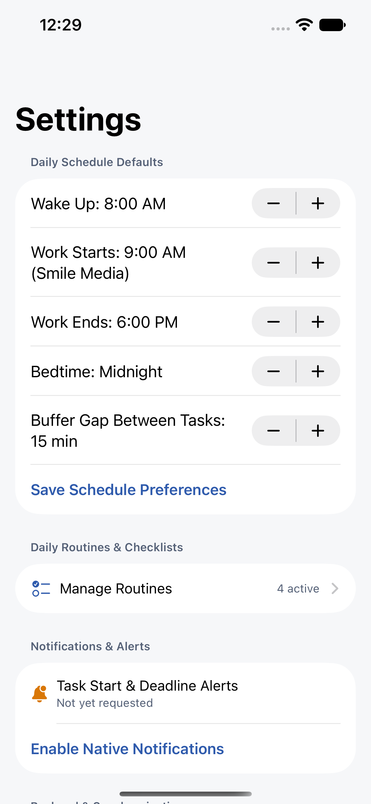
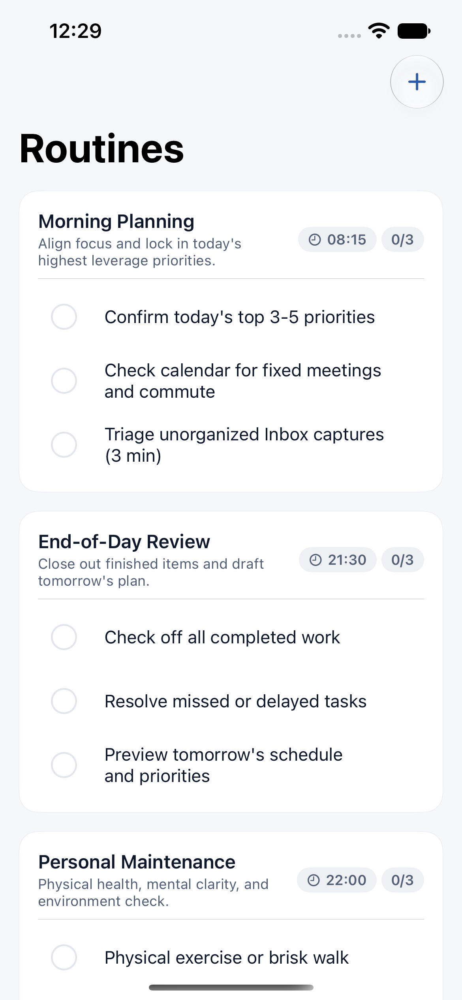

# Daymark — Native iOS Application

Daymark is a personal operating system for managing everyday life as a founder, business owner, product engineer, and business analyst. It helps answer three critical questions at any moment of the day:

1. **What should I do now?**
2. **What should I do next?**
3. **What genuinely matters today?**

Built entirely in **Swift 6 & SwiftUI** for **iOS 17.0+** using native Apple frameworks, clean domain architecture, a deterministic scheduling engine, offline-first local persistence, and Supabase synchronization readiness.

---

## Visual Showcase

| 1. Today View (Light) | 2. Today View (Dark) | 3. Quick Capture Inbox |
|:---:|:---:|:---:|
|  |  |  |
| Real-time focus, up-next, top priorities, chronological timeline | Complete dark mode support with calm alabaster/charcoal tokens | Quick capture title-only, filter chips, triage actions |

| 4. Workspaces & Ventures | 5. Workspace Detail | 6. Schedule Settings | 7. Daily Routines |
|:---:|:---:|:---:|:---:|
|  |  |  |  |
| Smile Media, TovMuk, SlidesClock, Personal, Opportunities | Milestones with target outcomes and true progress | Fixed work hours, buffers, bedtime, wake-up defaults | Habits & checklists without erasing completion history |

---

## Product Vision & Domain Model

Daymark unifies fragmented responsibilities across a founder's entire ecosystem:
- **Smile Media:** Full-time work, team alignment, core roadmap deliverables.
- **TovMuk Solution:** Agency client engagements, technical audits, delivery pipelines.
- **SlidesClock:** Startup venture, product engineering, onboarding and launch sprints.
- **Personal:** Health, habits, personal finance, environment reset.
- **Other Opportunities:** Strategic advisory, investments, new venture bets.

### Core Principles
- **Speed & Low Overhead:** Fast title-only quick capture everywhere.
- **Deterministic Scheduling:** No black-box AI hallucinations. Slot allocation strictly follows user work hours, priority, manual duration estimates, and 15-minute buffer gaps.
- **No Silently Dropped Work:** Overdue or missed tasks are flagged with explicit user choices: *Reschedule Today*, *Move to Inbox*, or *Dismiss*.
- **Routines Without Guilt:** Habits and checklists preserve historical completion without resetting destructively.

---

## Technical Stack & Architecture

- **Language & Runtime:** Swift 6 with Swift Concurrency (`actor`, `@MainActor`, `Sendable`).
- **UI Framework:** SwiftUI with Observation framework (`@Observable`, `@Environment`).
- **Design System:** Custom token architecture:
  - `ColorTokens.swift`: "Calm Executive" palette with Slate Cobalt accent (`#2E5AAC` light / `#5C82FF` dark), crisp cool slate canvas (`#F6F7F9` / `#0B0D12`), elevated card surfaces (`#FFFFFF` / `#151821`), and subtle hairline borders (`#E2E5EB` / `#262B38`).
  - `TypographyTokens.swift`: Native Apple SF Pro typography scale (`dmHero`, `dmLargeTitle`, `dmTitle`, `dmHeadline`, `dmBody`, `dmCaption`, `dmTime` monospaced).
  - `SpacingTokens.swift`: Systematic 4pt-grid spacing (`DMSpacing`), corner radiuses (`DMRadius`), and control heights (`DMControlHeight`).
  - Reusable components: `DaymarkCard`, `DaymarkButton`, `DaymarkCheckbox`, `DaymarkBadge`, `EmptyStateView`.
- **Scheduling Engine:** `SchedulingEngine.swift` calculates available capacity, creates non-overlapping `TimeSlot`s, prioritizes critical and milestone-linked tasks, and preserves buffer gaps.
- **Persistence:**
  - `LocalDaymarkRepository.swift`: Thread-safe actor persisting JSON stores to `Application Support/DaymarkData/` atomically.
  - Seeded automatically on first launch with starter workspaces, milestones, routines, and prioritized tasks.
- **Native Notifications:** `DaymarkNotificationManager.swift` schedules user-authorized start reminders and advance deadline warnings (30 minutes prior) using stable IDs (`task-start-<UUID>`, `task-deadline-<UUID>`).
- **Backend Readiness:** `SupabaseConfig.swift` and PostgreSQL schema documentation (`docs/SUPABASE_SETUP.md`) ready for seamless cloud sync.

---

## Project Structure

```
daymark-ios/
├── Daymark.xcodeproj/             # Native Xcode Project configuration
├── Daymark/
│   ├── App/
│   │   ├── DaymarkApp.swift       # App lifecycle entry point
│   │   └── ContentView.swift      # 3-tab root navigation (Today, Inbox, Workspaces)
│   ├── Core/
│   │   ├── DesignSystem/
│   │   │   ├── ColorTokens.swift
│   │   │   ├── TypographyTokens.swift
│   │   │   ├── SpacingTokens.swift
│   │   │   └── Components/        # DaymarkCard, DaymarkButton, DaymarkBadge, EmptyStateView
│   │   ├── Models/
│   │   │   ├── DaymarkTask.swift  # Task model with strict duration & title validation
│   │   │   ├── DaymarkProject.swift
│   │   │   ├── DaymarkMilestone.swift
│   │   │   ├── DaymarkRoutine.swift
│   │   │   ├── TaskImportance.swift
│   │   │   ├── TaskStatus.swift
│   │   │   └── UserScheduleProfile.swift
│   │   ├── Scheduling/
│   │   │   ├── TimeSlot.swift
│   │   │   ├── SchedulingEngine.swift
│   │   │   └── MissedTaskDetector.swift
│   │   ├── Persistence/
│   │   │   ├── DaymarkRepository.swift
│   │   │   ├── LocalDaymarkRepository.swift
│   │   │   ├── SeedData.swift
│   │   │   └── SupabaseConfig.swift
│   │   ├── Notifications/
│   │   │   └── DaymarkNotificationManager.swift
│   │   └── State/
│   │       └── AppState.swift     # Central @Observable @MainActor coordinator
│   └── Features/
│       ├── Today/                 # Overview, Focus Card, Daily Priorities, Timeline
│       ├── Inbox/                 # Fast capture, swipe actions, triage editor
│       ├── Projects/              # Workspaces list, Milestones, Project Detail
│       ├── Routines/              # Habit checklists & completion tracking
│       ├── DailyReview/           # Morning Confirmation & Evening Planning
│       └── Settings/              # Schedule defaults & notification controls
├── DaymarkTests/                  # Comprehensive XCTest suite (28 tests)
│   ├── DomainModelTests.swift
│   ├── DesignSystemTests.swift
│   ├── SchedulingEngineTests.swift
│   ├── MissedTaskDetectorTests.swift
│   ├── RepositoryTests.swift
│   ├── NotificationManagerTests.swift
│   └── AppStateTests.swift
├── docs/
│   ├── SUPABASE_SETUP.md          # Full PostgreSQL schema, RLS, indexes, and sync guide
│   └── screenshots/               # High-resolution simulator screenshots
└── scripts/
    └── generate_project.py        # Deterministic PBX project generator
```

---

## Verification & Automated Test Suite

Daymark includes an extensive automated test suite covering all critical engine behaviors, validation, and domain invariants:

```bash
# Execute unit test suite on iOS Simulator
DEVELOPER_DIR=/Applications/Xcode.app/Contents/Developer \
xcodebuild test -project Daymark.xcodeproj -scheme Daymark -destination 'platform=iOS Simulator,name=iPhone 17e'
```

### Test Coverage (28 / 28 Passed):
- `DomainModelTests` (6 tests):
  - Task title non-empty and non-whitespace validation
  - Estimated duration strictly positive validation
  - Task completion timestamp recording
  - Milestone outcome validation
  - Routine date-keyed completion tracking without history loss
  - User schedule profile defaults (8 AM wake, 9-6 work, midnight bedtime)
- `SchedulingEngineTests` (5 tests):
  - Critical and High priority tasks scheduled first
  - Work hours respect (no personal scheduling inside Smile Media work hours)
  - Zero overlapping scheduled slots
  - Buffer gaps (15-min) between tasks strictly maintained
  - Tasks exceeding daily capacity stay gracefully unscheduled
- `MissedTaskDetectorTests` (4 tests):
  - Overdue scheduled tasks flagged for review
  - Completed tasks never flagged as missed
  - Future tasks never flagged as missed
  - Zero silent auto-rescheduling without user consent
- `RepositoryTests` (3 tests):
  - Starter workspace and routine auto-seeding
  - Atomic JSON persistence survives repository re-instantiation
  - Full CRUD operations for tasks, projects, milestones, routines
- `NotificationManagerTests` (3 tests):
  - Stable notification IDs (`task-start-<UUID>`, `task-deadline-<UUID>`)
  - 30-minute advance deadline warnings
  - Scheduling triggered only for scheduled or high-importance tasks
- `AppStateTests` (4 tests):
  - Max 5 daily priority cap enforcement
  - Task promotion and demotion
  - Deterministic auto-schedule trigger
  - Missed task resolution actions (`rescheduleToday`, `moveToInbox`, `dismiss`)
- `DesignSystemTests` (3 tests):
  - Light and dark theme color token resolution
  - Typography token resolution
  - Spacing and corner radius consistency

---

## Build & Run Instructions

### Prerequisites
- macOS Sonoma or newer
- Xcode 16.0+ (Xcode 27 Command Line Tools / Toolchain)
- iOS 17.0+ Simulator (e.g. `iPhone 17e` or `iPhone 16 Pro`)

### Command Line Build
```bash
# Set Xcode developer directory
export DEVELOPER_DIR=/Applications/Xcode.app/Contents/Developer

# Build app scheme
xcodebuild build -project Daymark.xcodeproj -scheme Daymark -destination 'platform=iOS Simulator,name=iPhone 17e'

# Install & Launch on booted simulator
xcrun simctl install booted /Users/mac/Library/Developer/Xcode/DerivedData/Daymark-foeifkboxsytygaylmabvfbcewak/Build/Products/Debug-iphonesimulator/Daymark.app
xcrun simctl launch booted com.chhunsour.Daymark
```

---

## License

Personal and proprietary software for Chhunsour. All rights reserved.
